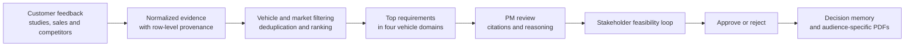

# BMW Product Intelligence

BMW Product Intelligence is a dependency-free product-management prototype that turns automotive customer feedback, market studies, sales planning, and competitor evidence into ranked, citation-backed vehicle requirements.

The application is designed for a BMW product manager preparing a new product cycle. The PM selects a vehicle and market, enters delivery constraints, reviews the resulting requirements, asks the suggested stakeholder to assess feasibility, and records final approvals or rejections. Every requirement retains a traceable path to the evidence that caused it to exist and influenced its rank.

> This repository is a prototype, not a production BMW system. Team-authored historical examples are explicitly marked as demo data and are not represented as verified BMW decisions.

## What problem it solves

Product teams receive thousands of feedback rows and several kinds of market evidence. Turning that material into a short, defensible requirement list is difficult because the team must answer all of these questions:

- Which customer needs occur repeatedly after duplicate classifications are removed?
- Which needs are relevant to the selected vehicle and country?
- How should limited time, team size, and deadline pressure affect priority?
- What evidence supports each requirement and where did it come from?
- Who should validate feasibility?
- Why was a requirement eventually approved or rejected?

This prototype keeps those answers together instead of separating the requirement list from its evidence and decision history.

## End-to-end workflow



1. **Define the product cycle.** Select a BMW vehicle, target market, time to market, available team, and deadline priority.
2. **Generate requirements.** The ranking engine filters evidence to the selected vehicle and market, removes low-quality input, deduplicates feedback frequency, and combines customer, study, sales, competitor, and delivery-context signals.
3. **Review the evidence.** Each requirement exposes separate explanations for why it exists and why it received its rank, plus exact source citations.
4. **Validate feasibility.** The application suggests a responsible department, prepares an editable email, and provides a Gmail compose link. It never sends the email.
5. **Process the response.** A pasted stakeholder reply can be interpreted as feasible, feasible with conditions, or not feasible. The PM must confirm the interpretation before it changes the requirement or ranking.
6. **Make the decision.** The PM can approve, approve with conditions, reject, or delete a requirement. Rejection recalibrates the affected group.
7. **Preserve and export.** Decision Memory records only approvals and rejections with their reasons. Structured PM, Technical, and GTM PDFs can then be generated.

## Main product areas

### Overview

The landing page establishes the product context. The current evidence includes BMW 1 Series/F70, 5 Series/G60, and 7 Series/G70 material across the markets available for each vehicle.

The PM controls:

- vehicle and target market;
- desired time to market;
- available team size;
- importance of protecting the deadline.

Changing these inputs and regenerating the cycle can change requirement fit scores and ranking.

### Requirements

Requirements are organized into no more than four stable BMW vehicle domains:

- **Interior & Comfort**
- **Digital Experience & Controls**
- **Driving & Powertrain**
- **Exterior & Utility**

Each domain contains at most ten supported requirements; fewer are shown when the evidence does not justify ten. Requirements are not padded to reach a fixed count.

Every requirement includes:

- an atomic outcome statement;
- its rank and priority score;
- unique evidence frequency and market-signal count;
- a suggested responsible entity;
- a planning estimate, not an engineering feasibility claim;
- “why this exists” and “why this rank” explanations;
- citations resolving to the original workbook, sheet, and row;
- approval, rejection, deletion, and feasibility actions.

PMs can also rename, split, merge, and recalibrate groups, move requirements, and edit requirement wording without losing the source evidence.

### Decision Memory

Decision Memory is intentionally narrow. It records only:

- approved requirements;
- requirements approved with conditions;
- rejected requirements;
- the PM-provided or generated reason for that decision.

Searchable timeline entries preserve the requirement, actor, timestamp, decision, reason, and supporting evidence. Ordinary navigation, report generation, group edits, and feasibility-only updates are not added to Decision Memory.

### PDF reports

The three exports serve different audiences:

| Report | Contents |
| --- | --- |
| **PM PDF** | Every requirement, separated into its primary Technical or GTM audience, followed by the approval/rejection decision record. |
| **Technical PDF** | Only requirements whose primary audience is engineering or technical delivery, including owner, status, evidence basis, representative sources, and routing rationale. |
| **GTM PDF** | Only requirements whose primary audience is go-to-market, including customer evidence, market signals, representative sources, and routing rationale. |

Technical and GTM assignments are mutually exclusive, so the two departmental reports are not duplicates. With OpenAI configured, a strict structured-output classification selects the primary audience. Without it, an inspectable deterministic classifier provides the fallback. The PM report always contains the complete requirement set.

## Evidence and traceability

The checked-in normalized store was produced from the supplied archive and competitor workbook. The current fixture contains:

- 13,771 feedback-classification rows;
- 1,003 customer-study rows;
- 12 sales-volume rows;
- 132 competitor signals;
- 13 competitor price references;
- nine copied source files with source metadata;
- three original PDFs with verified page counts.

`data/evidence.json` retains the original filename, sheet, source row, feedback ID, vehicle, market, classification, quality, and text. `data/context.json` contains studies, sales planning, competitor evidence, source metadata, and PDF page-count metadata.

Frequency is calculated from unique original feedback IDs within a feature—not raw spreadsheet rows—so one comment assigned to several classifications is not presented as several customers. Low-quality and unclassified feedback remains traceable in the evidence store but is excluded from generated requirements.

The prototype does not extract claims from the supplied PDFs because a reliable PDF parser is not installed. It exposes the original files and verified page counts without fabricating PDF text or page citations.

## Deterministic logic and OpenAI responsibilities

The system deliberately separates auditable calculation from language generation.

### Deterministic and inspectable

- vehicle/market filtering;
- feedback deduplication and quality exclusion;
- evidence selection and citation validation;
- BMW domain and outcome clustering;
- frequency, market, sales, competitor, and delivery-context scoring;
- ranking and the maximum of ten requirements per domain;
- fallback requirement wording, ownership, email, and report routing.

### OpenAI-assisted when configured

- rewriting requirement wording using only evidence attached to that requirement;
- redrafting the stakeholder email from PM notes;
- interpreting pasted stakeholder responses through a strict feasibility schema;
- assigning each requirement to one primary Technical or GTM report audience.

OpenAI cannot change the deterministic rank, feature, group, or selected evidence during requirement wording synthesis. Returned evidence IDs and claims are validated before the wording is accepted. Stakeholder interpretations never take effect until the PM confirms them.

## Running the application

### Prerequisites

- Node.js 20 or newer
- PowerShell 5 or newer only if you need to regenerate the evidence store
- An OpenAI API key for the optional AI-assisted features

There are no npm runtime dependencies to install.

### Start without OpenAI

The core evidence, ranking, citations, approvals/rejections, default email draft, Gmail link, deterministic report routing, and PDF exports work without an API key.

```powershell
npm start
```

Open [http://localhost:4173](http://localhost:4173). Wait for **Loading verified evidence…** to become **Generate requirements**.

### Start with OpenAI

PowerShell:

```powershell
$env:OPENAI_API_KEY='your-api-key'
# Optional; defaults to gpt-4o-mini
$env:OPENAI_MODEL='gpt-4o-mini'
npm start
```

macOS or Linux:

```bash
export OPENAI_API_KEY='your-api-key'
# Optional; defaults to gpt-4o-mini
export OPENAI_MODEL='gpt-4o-mini'
npm start
```

The API key is read only by the Node server. It is never returned to the browser or stored in browser local storage. Do not put keys in `public/`, committed files, or client-side code.

Do not open `public/index.html` directly or use a static-only preview server. The browser needs the API and evidence routes served by `server.mjs`. If the header reports an outdated PM API, stop the previous process with `Ctrl+C`, restart `npm start`, and hard-refresh the page.

## Suggested first demonstration

1. Start the server and open the Overview tab.
2. Keep **BMW 5 Series · G60** and **United States** selected.
3. Use 18 months, 12 people, and deadline priority 8/10.
4. Generate the requirements and open one vehicle domain.
5. Expand **Evidence & reasoning** and inspect the existence explanation, ranking explanation, and exact citations.
6. Return to Overview, change the delivery context, and regenerate to see its effect on ranking.
7. Open **Check feasibility**, inspect the suggested department and editable email, then paste: `Feasible, but it requires an additional three months.`
8. Process and confirm the interpretation.
9. Approve or reject the requirement and inspect its Decision Memory entry.
10. Export the PM, Technical, and GTM PDFs and compare their scopes.

## Regenerating the evidence store

The repository already includes normalized data, so this is optional. To ingest another archive and competitor workbook:

```powershell
powershell -ExecutionPolicy Bypass -File scripts\ingest-evidence.ps1 `
  -Archive 'C:\path\to\source-archive.zip' `
  -CompetitorWorkbook 'C:\path\to\competitor_bmw_format.xlsx' `
  -Output 'data\evidence.json'
```

The script reads the source files, rebuilds the normalized evidence and context stores, and copies inspectable originals to `data/sources/`. It does not modify the source archive or workbook.

## Testing

Run the complete test suite:

```powershell
npm test
```

The tests cover source presence, ingestion integrity, deduplication, exact vehicle/market filtering, citations, domain limits, ranking sensitivity, competitor and market evidence, feasibility recalculation, approval/rejection behavior, decision-memory boundaries, strict OpenAI outputs, departmental routing, and PDF generation/pagination.

## Repository structure

```text
public/
  app.js                 Browser workflow and state management
  engine.js              Deterministic requirement generation and ranking
  pdf-report.js          Dependency-free structured PDF renderer
  index.html             Application shell
  *.css / image assets   BMW-inspired responsive interface
src/
  openai.mjs             Server-side OpenAI integrations and validation
  report-routing.mjs     Technical/GTM routing and deterministic fallback
  decision-memory.mjs    Allowed decision-event types and reason handling
  engine.mjs             Test/runtime re-export of the browser engine
data/
  evidence.json          Normalized feedback evidence with provenance
  context.json           Studies, sales, competitors, and source metadata
  decision-events.ndjson Append-only approval/rejection records
  historical-decisions.json  Explicitly labeled demonstration history
  sources/               Original files available for inspection
scripts/
  ingest-evidence.ps1    Read-only source ingestion and normalization
test/                    Node test suite for product and audit invariants
server.mjs               Static file server plus server-side API routes
docs/acceptance-audit.md Detailed implementation and prototype-boundary audit
```

## Prototype boundaries

- Planning estimates help rank work; they are not engineering feasibility conclusions.
- Initial ownership suggestions are routing aids and remain PM-editable.
- Speech transcription depends on browser support and always has a typed fallback.
- The application drafts emails and Gmail compose links but never sends messages.
- Decision events are appended to NDJSON and mirrored in browser storage. Production use would require authentication, durable actor identity, tamper-evident signatures, access controls, backups, and retention policies.
- Competitor information used by the main requirement pipeline comes from the supplied, row-cited workbook. There is no separate Market Intelligence tab in the current interface.
- Historical demo decisions are clearly labeled and must not be treated as verified organizational history.

For a requirement-by-requirement implementation audit, see [`docs/acceptance-audit.md`](docs/acceptance-audit.md).
